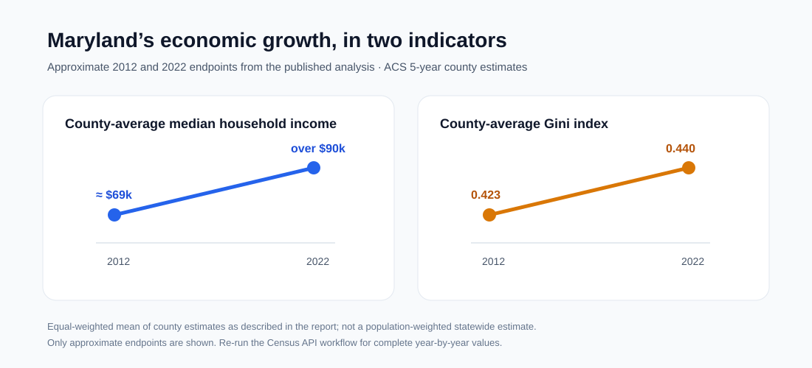

# Maryland County Income & Inequality

An exploratory analysis of Maryland county level income and income inequality using U.S. Census Bureau American Community Survey (ACS) 5-year estimates.

[Published analysis](https://medium.com/inst414-data-science-tech/the-economy-of-maryland-has-been-developing-steadily-year-by-year-but-whats-the-cost-147b667abb3a) · [Census API](https://api.census.gov/data/)

## At a glance

The published report compares five ACS 5-year estimate releases (2012, 2014, 2016, 2018, 2022) for Maryland’s 24 counties. It examines median household income (B19013_001E) alongside the Gini index (B19083_001E).



The reported county-average median household income rose from about $69,000 in 2012 to over $90,000 in 2022; the mean county Gini index rose from 0.423 to 0.440. These are approximate endpoints transcribed from the published report, shown as a compact summary rather than a replacement for the API workflow.

## Data and method

- **Source:** U.S. Census Bureau ACS 5-year estimates, queried from the official Census API at run time. No Kaggle dataset is used.
- **Geography:** Maryland counties (state FIPS 24); the expected set contains 24 county-equivalent records.
- **Measures:** median household income and Gini index, fetched for each selected ACS release.
- **Summary:** the script calculates mean and median across county estimates for each release, then calculates county-level income/Gini correlations by release and across pooled observations.
- **Reproducibility:** the script requests the API live; results can change as API availability and documentation evolve. The repository does not contain a frozen source-data snapshot.

## How to run

Requires Python 3 and the packages `requests`, `pandas`, and `matplotlib`.

```bash
python -m pip install requests pandas matplotlib
python data_maryland.py
```

The script prints the county-average summaries and correlations, then opens two trend plots. It skips failed year requests and reports them at the end; a run with no successful year stops with an error.

## Interpretation and limitations

- ACS 5-year estimates are overlapping rolling periods, not single-year measurements. Treating their labels as annual observations overstates temporal resolution.
- The plotted statewide trend is an **unweighted mean of county estimates**. Each county contributes equally; this is not the Census state-level median and is not population-weighted.
- The pooled correlation combines repeated observations of the same counties across releases. Read it as descriptive, not as independent evidence; within-release correlations are more interpretable but remain observational.
- County aggregates conceal within-county differences. The script does not model margins of error, inflation-adjust income, or test statistical significance.
- Correlation does not establish that income growth causes inequality to rise. The Gini index concerns income distribution, not wealth, cost of living, or access to opportunity.

## Project files

| File | Purpose |
| --- | --- |
| `data_maryland.py` | Queries ACS county data, calculates descriptive summaries and correlations, and displays trend plots. |
| `assets/maryland_trend_snapshot.svg` | Visual summary of approximate endpoints stated in the published report. |

## References

- U.S. Census Bureau. [ACS 5-year data API](https://api.census.gov/data/).
- U.S. Census Bureau. [American Community Survey](https://www.census.gov/programs-surveys/acs/).
- [The economy of Maryland has been developing steadily year by year, But what’s the cost?](https://medium.com/inst414-data-science-tech/the-economy-of-maryland-has-been-developing-steadily-year-by-year-but-whats-the-cost-147b667abb3a).
